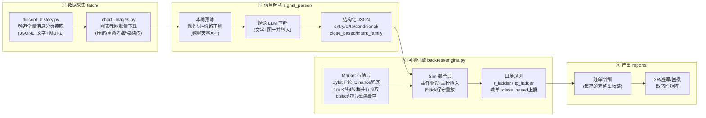
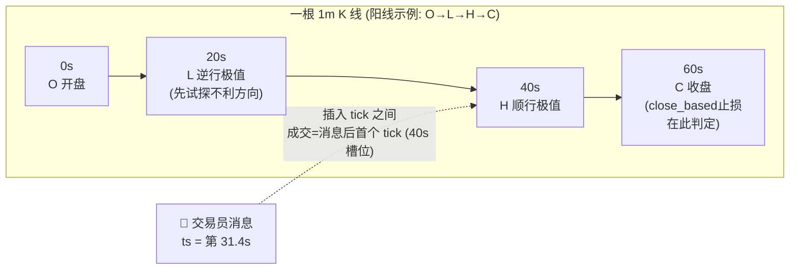

# Signal Vision Backtest — AI 视觉信号解析 + 1m OHLC 事件驱动回测引擎

[](https://github.com/0xAlchemist-cs/signal-vision-backtest/actions/workflows/ci.yml)
[](https://github.com/0xAlchemist-cs/signal-vision-backtest/actions/workflows/ci.yml)

基于 Python 的交易员频道信号研究工具链：把 Discord/Telegram 频道里的**文字 + 图表截图**交给视觉大模型（GLM / Qwen-VL / GPT-4o 等任意 OpenAI 兼容接口）解析成结构化交易指令，再以**可配置的分钟内价格路径假设**(1m OHLC → 0/20/40/59.999s 四 tick)在 1 分钟 K 线上逐条回放，回答一个核心问题——

> **"如果当时跟了这位交易员，会怎么样？"**

> ⚠️ **风险提示**：本项目仅作为技术工具与研究成果，**不构成任何投资建议**。
> 自动化使用个人账号(self-bot)访问 Discord 违反其 ToS 且有封号风险——生产使用请改走官方 Bot 接口或授权数据导出；自动交易风险极高，
> 回测表现不代表真实盘结果（滑点、深度、延迟均会让实盘劣于回测）。

## 一、为什么需要"视觉"解析

真实交易员频道的信号有三个特征，纯文本/正则方案必然失败——这是我们对多个真实频道约两年历史逐条回测的实测结论：

1. **价位在图上**：止损/止盈经常只以红线/绿线画在 TradingView 截图里。实测某频道 **64% 的信号止损只存在于图上**，纯文本解析等于直接丢掉 2/3 的信号；
2. **口语化混合指令**："现价 1038 短多，止盈 1135 平一半，成本防守，980 补，945 止损"——一句话包含市价入场 + 分批止盈 + 保本移损 + DCA 补仓腿 + 硬止损五种语义；
3. **收盘价止损**："4H 收盘跌破 1865 才空"——盘中插针不算触发。**是否建模这一条，同一套信号的回测结果相差数十个 R**；
4. **图文错配与战报**：交易员会发错图/引用旧图；"booked +6R"式战报帖会被 naive 正则管线当成新开仓交易。

## 二、功能特性

- **视觉直解**：文字 + 图表一并交给视觉大模型，输出结构化 JSON（symbol / side / entry / sl / tp_levels / order_type）；文字数字优先，图只补缺与纠错（逐位读标签并与价格轴刻度交叉核对）
- **本地预筛**：免费的动作词+价格正则门禁，纯聊天/科普帖不打 API
- **信号语义打标**：
  - `conditional`——条件单（"出现 X 情况则右侧做空"），按挂单语义只在触发价成交，48h 未触发计为未成交
  - `stop_trigger_type=close_based`——收盘价止损（"4H 收盘跌破"），回测只在对应周期收盘 tick 判定，**盘中插针不触发**
  - `intent_family`——OPEN / RESULT / ANALYSIS / NOISE 四族分类，战报帖与教学帖不会污染回测
- **1m OHLC 事件驱动回测**：每根 1m K 线按可配置假设展开为 开盘(0s) → 逆行极值(20s) → 顺行极值(40s) → 收盘(59.999s) 四个合成 tick，消息按原始毫秒时间戳插入 tick 之间；成交=消息后首个 tick（保守重放设计致敬 [VeloTradeX](https://github.com/VeloTradeX/velotradex)，MIT）。**这是路径假设而非采集的秒级行情**——真实最高/最低价的出现顺序未知，结论应配合悲观/乐观路径对照解读
- **单标的喊话频道模板**：黄金/外汇 CFD 类"单一标的 + 高频喊话事件流"频道用 [`backtest/voice_event_engine.py`](backtest/voice_event_engine.py)——1R 出场动作（全平/平半+保本/只保本）、获利了结/移保本/全平三类喊话、固定手数或固定风险定量，见[第九节](#九单一标的喊话频道事件驱动回测模板)
- **两种出场规则对照**（`SVB_RULE`）：
  - `r_ladder`（默认）：**+1R 平 40% 并移保本 → +2R 再平 40% → 剩余 20% 只听喊单**
  - `tp_ladder`：完全按交易员公布的止盈位执行，N 档各平 1/N
- **真实成本建模**：市价/止损单滑点（可调档做敏感性矩阵）、taker 手续费、按持仓期逐段计入真实资金费率
- **工程细节**：行情/图片/消息三类出口全部域名白名单 + 解析 IP 私网拦截 + 禁重定向；K 线 4 线程并行预取 + bisect 切片；内存占位可控（长历史不 OOM）
- **可审计**：语料/信号/管理消息 SHA256 审计哈希，任何口径改动都可追溯
- **漏检检测器**：`signal_parser/missed_detector.py` 自动扫描解析后仍疑似含开仓指令的纯文字消息，量化信号覆盖率缺口

## 三、回测规则对照（为什么要做两种）

同一批入场信号，只换出场规则，我们对多位真实交易员约两年历史的对照结果：

| 出场规则 | 交易员 A | 交易员 B |
|---|---|---|
| `r_ladder`（R 值管理） | **+6.1R**（胜率 60%，回撤 -8.0R） | **+47.5R**（胜率 55%，回撤 -5.5R） |
| `tp_ladder`（照抄交易员自设止盈止损） | **-17.7R**（胜率 27.5%，回撤 -31.1R） | — |

- **进场有优势 ≠ 自设止盈位是最优出场**。两位交易员自设的止盈位普遍挂在 2–4R 开外，价格在止损前到达 TP1 的频率不足以覆盖回撤单；
- 标准化的"早落袋 + 保本"纪律把进场优势兑现成曲线，而照抄指令把同一优势浪费在够不到的远端止盈上；
- 交易员后续的**喊单**（移损/部分止盈/全平）在两种规则下都作为离场事件保留。

## 四、系统架构

### 3.1 数据流总览



### 3.2 撮合时间轴（1 分钟 K 线 → 4 tick）



- 阳线走 `O→L→H→C`、阴线走 `O→H→L→C`——同根 K 线内**先试探对持仓不利的方向**，
  避免"TP/SL 同根 K 线永远先成 TP"的乐观偏差（保守重放设计致敬
  [VeloTradeX](https://github.com/VeloTradeX/velotradex)，MIT）；
- 交易员的后续喊单（移损/分批止盈/全平）与资金费时点同样按毫秒插入，
  作用于当时仍持有的仓位。

### 3.3 组件说明

| 组件 | 文件 | 职责 | 关键设计 |
|---|---|---|---|
| 频道抓取 | `fetch/discord_history.py` | 分页拉取频道全量消息 → JSONL | 域名白名单 + 解析 IP 私网拦截 + 禁重定向 + 429 退避 |
| 图表下载 | `fetch/chart_images.py` | 附件图批量下载压缩（≤1280px） | CDN 白名单；签名 URL 过期前及时抓取 |
| 信号解析 | `signal_parser/parser.py` | 文字+图 → 结构化 JSON | 本地预筛省 API；文字数字优先、图只补缺纠错；四族分类过滤战报/教学帖 |
| 行情层 `Market` | `backtest/engine.py` | 合约解析 + 1m K 线缓存 + tick 展开 | Bybit 主源 Binance 兜底；4 线程并行预取 + 条件变量等待；缺口分段补拉；非活跃标的内存驱逐 |
| 撮合层 `Sim` | `backtest/engine.py` | 事件驱动持仓管理 | R 阶梯/TP 阶梯双规则；喊单三类动作（止盈/移损/全平）按消息时间戳插入 tick 生效；资金费逐期计入；30 天持仓上限 |
| 报告 | `backtest/engine.py` | 逐单明细 + ΣR/胜率/回撤 | 出场链完整可溯（每笔含 1R/2R/喊单/止损的精确时点） |
| 喊话频道模板 | `backtest/voice_event_engine.py` | 单标的(黄金/外汇 CFD)事件流回测 | +1R 动作四档参数；喊话事件三类；市价型信号首 bar 成交；腿级记账 |

## 五、快速开始

```bash
pip install -r requirements.txt

# 1) 配置（OpenAI 兼容视觉模型 + Discord 账号 token）
export SIGNAL_API_KEY=...
export SIGNAL_API_BASE=https://open.bigmodel.cn/api/paas/v4
export SIGNAL_MODEL=glm-4.5v
export DISCORD_TOKEN=...

# 2) 拉取频道历史 + 图表
python -m fetch.discord_history <channel_id> data/channel.jsonl
python -m fetch.chart_images data/channel.jsonl data/images/

# 3) 解析一条信号（文字 + 图）
python -m signal_parser --text "long ETH at cmp, 4h close under 1865 stops, tp 1750" --image chart.jpg

# 4) 回放（WORK 目录下准备 signals.json / manages.json，样例见 examples/）
export SVB_WORK=./work
python backtest/engine.py sim
python backtest/engine.py report
```

### 环境变量

| 变量 | 说明 | 默认 |
|---|---|---|
| `SIGNAL_API_KEY` / `SIGNAL_API_BASE` / `SIGNAL_MODEL` | LLM API（强制 https） | GLM 官方端点 / glm-4.5v |
| `DISCORD_TOKEN` | Discord 账号 token（仅本地使用，勿提交） | — |
| `SVB_WORK` | 回测工作目录（signals/manages/K线缓存） | `./work` |
| `SVB_RULE` | 出场规则：`r_ladder` / `tp_ladder` | `r_ladder` |
| `SVB_RISK_USDT` | 每单固定风险（U） | `25` |
| `SVB_SLIP` | 市价/止损单滑点（每边，做敏感性矩阵用） | `0.0005` |
| `GR1_LVL` / `GR1_FRAC` / `GR2_LVL` / `GR2_FRAC` | R 阶梯参数 | `1.0 / 0.40 / 2.0 / 0.40` |

## 六、信号 JSON 格式

见 [`examples/`](examples/)。核心字段：

```jsonc
{
  "symbol": "ETH", "side": "SHORT",
  "order_type": "MARKET",            // MARKET=现价; LIMIT=挂单/区间
  "entry_prices": [1865],            // 多腿区间全列
  "sl": 1892, "sl_source": "text",   // 止损来源: text(文字) / chart(图读)
  "stop_trigger_type": null,         // "close_based" = 收盘价止损
  "stop_timeframe": "4H",
  "conditional": true,               // 条件单: 满足条件才进场
  "tp_levels": [1820]
}
```

## 七、正则解析（刚性格式频道的另一条路）

> 适用前提：频道格式规整（标的+方向+区间+SL+TP 阶梯）。自由文本与图表请回到视觉解析主线——两者是分工不是替代。

### 为什么正则优先

同一 112 条人工核验信号集的实测对比：

| 解析方式 | 覆盖 | 单条成本 |
|---|---|---|
| AI 文本直解 | 109/111 | 每条一次 API 调用 |
| 字段化正则（三层） | **111/111** | **零** |

图表止损仍必须视觉解析（见第一章）；但文字区单正则可以全包，AI 只兜底未知格式。

### 三层解析架构

```
消息 ─► ① 主正则（频道方言语法，见下表）
     ─► ② 独立校验器（同一语法的第二实现，与①互查漏）──命中──┐
     ─► ③ AI 兜底（仅当含 SL/止损字样且①②都没吃下）────────┴─► 开仓参数
管理消息 ─► 动作词表（见下）──► partial / move_be / close_all / add_dca / cancel_dca / cancel_legs
```

### 方言语法表（全部真实样本实证）

| 变体 | 示例 | 处理要点 |
|---|---|---|
| 标的方向连写 | `BTC空 114200-114800` | 边界断言只排除 ASCII——中文是 unicode word 字符，`\b` 会失配 |
| 入场三形态 | `82200-82700` / `78500 上下200点` / `109700附近`、`现价89700左右` | 区间 / 中心±偏移 / 单点 |
| 分批腿 | `110600-111000 / 补仓109200`、`87800第一注 / 86000第二注` | 解析为多入场腿 |
| 繁简混写 | `止損` `現價` `補倉點` | 正则字符集双收 |
| 回复引用内嵌新单 | `> 回复 @…[旧单预览…](url)` + 正文新单 | 引用行整行剥离（预览含旧 SL/价格会截胡），正文重走开仓解析 |
| 方向词在标的前 | `反手做空 BTC…`、`多比特币…` | 方向词搜索窗口包含标的前短语 |
| 区间笔误 | `60900-91300`（3 分钟后自行更正为 60900-61300） | 跨度 >10% 拒收，等修正版 |
| TP 笔误 | SHORT 单 TP 方向写反 | 保留信号、TP 置空并标记异常，不拒收 |
| 纯市价单 | `btc 多 / 现价 / sl 89000` | 无入场价，规则化跟单无法挂限价 → 推人工 |

### 管理动作词表（触发原话均为实测）

| 动作 | 实测触发原话 |
|---|---|
| partial | `先吃30%` / `当tp1止盈50%` / `再止盈一部分`（比例未说 → 默认 30% 并标记） |
| move_be / stop_move | `止损移到开单点` / `睡前止损要上移到85400` / `SL 统一修改为113000` |
| close_all | `可以全部止盈` / `先离场` |
| add_dca | `加一个补仓点 112200`（可同帧带统一移损；"补仓后均价X"是状态播报，价格不紧跟补仓点就不算动作） |
| cancel_dca | `取消补仓`（常与移保本同发） |
| cancel_legs | `没进到，取消` |
| tp_hit | `TP1到了` → 保本节奏听交易员播报，不跟自己的成交 |

### 语料回归方法论

1. 人工核验信号集当 ground truth（逐条对过 K 线确认真实成交）；
2. 正则任何改动跑**全量历史语料回放**：覆盖率不得下降、误报必须为零；
3. **两套独立实现对跑**互相查漏——实测从 93/111 补到 111/111 的差距全是这么找出来的；
4. 解析层识别 ≠ 执行层跟单：无 TP 单、纯市价单被完整识别后仍按策略推人工，两层职责分开。

### 与 VeloTradeX 的分工（不重复造轮子）

上游 [VeloTradeX](https://github.com/VeloTradeX/velotradex)（MIT）已有按频道定制的正则解析器族（`GaulsParser`/`KacangParser`/`MansoorParser`/`WWGParser` + AI 兜底），生产链路直接沿用该架构。本节沉淀的是上游尚无的增量：引用内嵌新单（上游把"有引用"一律当旧仓管理上下文）、DCA 动作族、状态播报消歧、笔误护栏与两层对跑方法论。

## 八、实测教训（二次回测前的必修课）

| 教训 | 后果（若不做） |
|---|---|
| **纯文字口语开仓单漏检** | 实测某频道 53 条纯文字开仓指令被管线遗漏（默认只送管理解析不送开仓解析）；已加 `missed_detector.py` 量化缺口 |
| **回复引用消息内嵌新单漏检** | 交易员在"回复引用旧单"的正文里发新单（如"昨天挂单取消 + 轻仓介入 85200-85600"），只解析引用头会整类漏掉；实测补录 61 条（46→102 笔平仓），结论方向都被改变 |
| **管理消息字段键名对齐** | 生产解析产出 `new_sl`，回测引擎只认 `new_stop`/`stop_price` → 显式移损价被静默退化成保本价（实测 13/30 条移损受影响）；字段映射要有对账用例 |
| **中途补仓/取消补仓是独立管理动作** | 只建模 partial/be/close 的话，"加一个补仓点 112200 / SL统一修改为113000"要么丢动作要么误判开仓；且"补仓后均价X"是状态播报不是指令，要按"价格紧跟补仓点"消歧 |
| **正则全中、AI 漏检的量化证据** | 同一 112 条人工核验集：字段化正则 111/111，AI 文本解析漏 2 条。刚性格式频道应正则优先、AI 兜底（省 token 且更准）；AI 留给自由文本与图表 |
| **换新撤旧路径不打 status 标签** | 引擎"新信号顶旧仓"路径结束的仓位缺 status 字段，报告若按 `status=="closed"` 分流会把 14 笔已平仓交易误分类成跳过；以"有无 R 值"分流才对（88→102 笔，结论上修） |
| 图上止损必须视觉解析 | 丢掉 2/3 信号，且漏掉的恰是质量最高的部分 |
| 收盘价止损按周期收盘判定 | 正期望策略在回测里变负（插针误杀） |
| 战报/教学帖过滤（AI 四族分类） | "+6R booked"被当新开仓，虚增胜率与利润 |
| 限价挂在可立即成交一侧按市价处理 | 大量"CMP till X"信号被误判 48h 未成交 |
| 同批信号跑双出场规则 | 无法区分"进场有优势"与"出场占便宜" |
| 同频道不同时期可能不是同一交易员 | 文体指纹按季检验；全历史数字不能视为同一人的战绩 |

### 黄金/CFD 喊话频道回测追加教训（第二轮实测）

| 教训 | 后果（若不做） |
|---|---|
| **Discord 图片 CDN 签名 URL 过期 ≠ 图片丢了** | 附件 URL 带 `ex/is/hm` 签名参数会过期失效；重新 GET 一次频道消息 API 即可拿到新鲜签名 URL，消息还在图就能恢复——不要轻易把"图片过期"当成"信号不可回测" |
| **晒仓截图 ≠ 信号图** | 图片要先分类再解析：TradingView 画框图=信号（有 Entry/SL/TP 标签），持仓截图=晒仓（没有价格结构）。把晒仓图硬凑参数进回测会污染样本 |
| **只给 SL/TP 不给 Entry 的"市价型"信号必须成交** | 用消息后首根 1m 收盘价市价成交，不要跳过——实测同一数据集，跳过这半数样本与正确成交的结果相差一个数量级（+59U vs +1,240U），方向性结论完全不同 |
| **喊话事件（获利了结/移保本/全平）必须建模** | 漏掉其中一类事件分支（如只在部分方案里处理"获利了结"），6 个月口径直接少 739U 且出场结构失真；事件处理代码要按 `kind × ev` 矩阵写全测试 |
| **新信号撞旧仓的口径要显式且对齐实盘** | "一律平旧开新" vs "同向忽略只反向换仓"，同一数据差 1,500U+；先看交易员实盘怎么做的，再把口径写成参数 |
| **部分平仓按"腿"记账，报告写清口径** | 1R 平半 + 尾仓 TP 是两条腿：~143 笔交易 ≈ 186~314 腿（取决于规则）。交易数与腿数混用会让读者以为数字对不上 |
| **权益曲线横轴用真实日期** | 用"腿序号"做横轴时，两方案腿数不同会视觉错位——腿少的方案看起来像"后半段没数据" |
| **正式结论必须来自可复现脚本** | 数据文件会被下一次抓取覆盖，历史报告从此不可复现；引擎落盘成脚本+参数化，报告数字以脚本重跑为准 |
| **跟单品种用什么数据源就用什么回测** | 黄金/外汇 CFD 用 CFD 现货报价（如 Gate TradFi `/tradfi/symbols/XAUUSD/klines`），不要拿期货/合约 K 线凑——基差会误判 TP 触达 |
| **图上读价：价格标签 > 目测框体** | TradingView 截图右侧的现价/SL/TP 标签是精确值，框体边界只做交叉验证；他文字喊的 RR 与图上框体不一致时以图为准（"1:14RR"实测图上只有 7R） |

### 第三轮实测：机器人镜像频道与负结论审计

| 教训 | 后果（若不做） |
|---|---|
| **机器人镜像频道的图表在 `embed.image`，不在 attachments** | 转发机器人（如各类"-bot"镜像）把图表挂在 embed 的 image/thumbnail 字段，Discord 客户端里"看得见图"；只抓 `attachments` 的抓取器会漏掉 100% 图表。修复=把 embed image/thumbnail URL 并入附件列表；同时 embed 图走 `media.discordapp.net` 域，下载白名单要包含。用户一句"我明明看得见图"就是此 bug 的签名 |
| **caption 只有 ticker 的频道：带图消息本身就是候选** | "XAU"+图 式频道里 caption 无任何关键词，关键词门禁会把带图信号全拒（实测 147 条候选里只剩 18 条）。判据：**附件消息数 ≫ 关键词候选数** 即为此类频道，候选集合应为"全部带图消息 + 关键词命中的纯文字" |
| **限价被行情穿越 → 信号已失效，必须跳过** | 交易员发图滞后于行情时挂单价已被穿越：按交易所语义（挂立即成交一侧按市价成交）成交后，止损落在成交价错误一侧，风险分母趋零，单笔爆出 -12.3R 假亏损。引擎护栏：成交价穿越止损 → 记"信号失效"跳过 |
| **紧止损剥头皮频道：负结论前必做三重复测** | 止损 <0.3% 的 scalp 在 1m 保守撮合下疑似被系统性向下偏差。复测协议：① 亲自重读 N 张原图逐位比对（别信子代理/解析器）；② 逐笔回查止损触发前 TP 是否曾被触及（量化同 bar 歧义）；③ 零滑点重跑。实测某频道三重复测后：读图逐位一致、0 笔歧义、零滑点仍为负——负结论才站得住。**若乐观边界翻正，结论只能是"1m 粒度不可判定"而非"亏损"** |
| **自报战绩用 K 线审计，但注意双向可能** | 宣称 "+XR" 用 K 线复算：止损在宣称时间前已触及 → 虚假战报实锤（实测有人 "+1.5R" 实为 88 分钟打损 -1R）；但图表型交易员的自报若无价位锚点则**无法审计**，报告应写"透明度存疑但无实锤"，两种情况都要披露 |
| **CFD 数据喂给 24/7 引擎前先填周末缺口** | CFD 周末休市的缺失分钟会被为加密设计的引擎判定为数据缺口，转而拉取同名加密代币（如 XAU→XAUT）补洞——两种价格体系混源，接缝基差污染持仓过周末的单。喂入前用平盘 minute 填充缺口，喂完校验缺口数=0 |
| **不可测判定要诚实输出** | 只镜像文字、图在源头的频道（0 条含价格的信号）应输出"不可回测判定"并说明缺什么，而不是硬凑一个回测——诚实的不结论比编造的结论有用 |

## 九、单一标的喊话频道：事件驱动回测模板

黄金/外汇类频道通常是**单一标的 + 高频喊话事件流**（开仓、获利了结、移保本、全平、反手），与多标的加密频道不同。[`backtest/voice_event_engine.py`](backtest/voice_event_engine.py) 是这类频道的轻量模板（~300 行，仅标准库）：

**输入契约**（两个 JSON）：

```jsonc
// events: 按时间排序的事件流
[
  {"ts_ms": 1775809818145, "kind": "signal", "side": "BUY",
   "entry": 2000.0, "sl": 1990.0, "tp": 2030.0},
  {"ts_ms": 1775810000000, "kind": "manage", "ev": "secure_profit"}  // 获利了结
  // ev ∈ secure_profit(平半+移保本) | be_set(移保本) | close_all(全平)
  // entry=null 的市价型信号 → 消息后首根 1m 收盘价成交
]
// klines: [[ts_ms, open, high, low, close], ...] 单标的 1m K 线
```

**规则参数**（CLI 全部可调）：

| 参数 | 取值 | 说明 |
|---|---|---|
| `--r-action` | `flat` / `half_be` / `be_only` / `none` | 价格到 +1R 时：全平 / 平半+移保本 / 只移保本 / 不动作 |
| `--sizing` | `fixed` / `risk` | 固定手数 / 每单固定风险（风险÷SL距离，钳制上下限） |
| `--on-new-signal` | `close_and_open` / `ignore_same_dir` | 新信号一律平旧开新 / 同向忽略 |
| `--entry-timeout-min` | 分钟 | 限价单超时作废（默认 24h） |

**撮合口径（刻意保守）**：同根 1m K 线内先查 SL、再查 +1R、最后查 TP；限价成交要求 `low ≤ entry ≤ high`；每条腿独立记账（部分平仓产生多条腿）。

```bash
python -m backtest.voice_event_engine \
  --events events.json --klines XAUUSD_1m.json \
  --sizing fixed --lots 0.02 --r-action half_be --on-new-signal close_and_open \
  --out result.json
```

## 研究偏差披露（阅读任何回测数字前必读）

1. **分钟内路径假设**：1m OHLC 无法还原真实价格路径，四 tick 是一种保守假设；对紧止损（<0.3%）剥头皮风格，同 bar 先查止损的口径会显著影响结果——此类频道必须配合悲观/乐观路径对照解读。
2. **幸存者偏差**：行情拉取基于当前在市合约，历史退市标的不在数据集中——高换手山寨频道的结果存在向上偏差。
3. **成本口径**：资金费拉取失败按 0 计（覆盖率未在报告展示）；手续费/滑点为常量假设，未做深度建模。
4. **样本选择偏差**：报告只统计成功解析的交易；解析候选数、漏检率与拒绝原因应以审计哈希+候选文件配合人工核验。
5. **止损触发 vs 成交**：触发判定用原始止损价，跳空越过止损时按 tick 价成交（更差者）——自 v0.2.0 起生效，此前版本此处有偏差。

## 十、免责声明

本项目仅作为**技术工具与研究成果**，不构成任何投资建议。自动交易风险极高，可能导致本金全部损失；回测存在撮合近似（1m 四 tick）、滑点假设、退市标的缺失等已知偏差，回测表现不代表真实盘结果。使用本工具抓取 Discord 内容请自行确认符合 Discord 服务条款及当地法律法规。信号内容的知识产权属于原发布者，请勿在未授权情况下转发或商用其信号。

## v0.2.0 修复记录（外部代码审查回应）

- **P0**：多腿订单在成交前参与盈亏（fill_ms 激活检查）；candles() 分钟对齐丢失同 bar 后续 tick；换新撤旧交易未标记 status 漏出报告；voice_event_engine 参考价/成交价前视偏差；STOP 入场语义（触发方向与限价相反 + close_based 周期收盘确认）；止损触发判定误用滑点后价格（改为原始价触发、跳空按 tick 价成交）
- **P1**：.env 解析条件反转；Binance Futures 域名改为 fapi.binance.com；报告除零；信号解析"有图必送"；示例 JSON 空单方向；`python -m signal_parser` 入口
- 新增回归测试（tests/）与 CI

## v0.2.2 修复记录（第二轮外部审查回应）

- **P0-1**：撤销"close_based 止损 → STOP 入场"的错误映射——止损触发语义与开仓订单类型是两个独立概念；条件入场改由独立的 `entry_trigger_type`/`entry_timeframe` 字段承载
- **P0-2**：STOP 入场的滑点成交价进入记账（entry/risk_unit/手续费/R 全部按实际成交价）
- **P0-3**：voice 引擎重写为 PENDING/FILLED 状态机——限价单成交前不可被管理动作平仓、成交前的 close_all=撤单、参考价严格取已完成 bar
- **P0-4**：`SVB_PATH_MODE=synthetic|worst|best` 三种分钟内路径假设 + 同 bar TP/SL 冲突分钟计数进报告
- **P1**：撤单腿不再收开仓手续费；BE=已成交腿**实际数量**加权均价（等风险≠等数量）；资金费缺失标的进报告数据质量行；测试重写为真实撮合路径的集成测试（FakeMarket+完整状态机），CI 增加干净安装 smoke

## v0.2.3 修复记录（第三、四轮外部审查回应）

- **P0-1（主引擎）**：管理消息改为 peek/确认消费——25s 的移损指令在 30s 推进截止截断 tick 后不再永久丢失，留回队列在数据末尾前继续生效
- **P0-2（voice）**：PENDING 挂单的事件分发不再用统一 continue 吞掉一切——新信号按 on_new_signal 撤旧挂单/开新仓；成交前的 close_all=撤单（保守），成交前的 BE/部分止盈被忽略
- **P0-3**：parser 把原始 text 写进输出（条件入场启发式可用）；引擎读独立的 entry_trigger_type/entry_timeframe（不再借用止损字段）；STOP 同时支持 intrabar 与 close_based 两种触发
- **P0-4**：SVB_PATH_MODE=synthetic|low_first|high_first；voice 引擎 FILLED 走查（含尾部）全部 tick 化——同 bar TP/SL 冲突按路径模式解析，不再固定先查止损
- **P1**：BE 加权排除已全平腿并按剩余数量；资金费请求域名改 fapi.binance.com；撤单腿免手续费；CLI smoke 不再吞失败
- 回归测试 23 个，覆盖审查给出的全部 8 个场景

## v0.2.4 修复记录（第四轮复核回应）

- **P0-A**：修正 test_voice_new_signal_cancels_pending 的无效参数（原 SL 高于 entry、TP 低于 entry → 挂单从未进入 PENDING，测试假阳性）；有效挂单 + 反向信号 → 旧单撤销、新仓建立、盈亏链全验证
- **P0-B**：close_all 不再直接清除 PENDING——先推进**事件时刻之前已完成 bar** 的成交确认，再按真实状态平仓/撤单（同分钟不可分辨才保守撤）
- **P0-C**：FILLED 推进的 tick 循环加 `tms > ts` 过滤——事件(10:01:30 全平)之后同 bar 的未来 tick(10:01:40 TP)不再抢先执行
- **P0-D**：字段契约统一——LIMIT + entry_trigger_type=close_based 由执行层按 STOP 撮合（与解析层同一规则）；官方 examples/conditional_signal.json 的端到端集成测试验证 fill 精确落在 4H 收盘 tick
- **P1**：CLI smoke 改 `--help` 真实验证退出码（不再 `|| echo` 吞失败）；voice 市价 fill_ts 边界 = max(bar 末, 消息时刻)；BE 权重确认含 remain_frac（剩余数量）；funding 域名确认 fapi.binance.com
- 回归测试 33 个（23 → 33，新增第四轮 10 个场景）

## v0.2.5 修复记录（第五轮复核回应）

- **P0-1（voice）**：FILLED 走查（含尾部）起点由 `bisect(starts, lw)` 改为 `lw // 60_000` floor 对齐——lw 停在分钟中间（如 01:30 的移保本指令）时不再跳过该分钟剩余 tick（旧 bug 会永久漏掉 01:40 的 TP）；已处理 tick 由 `tms <= lw` 过滤兜底
- **P0-2（主引擎）**：STOP 触发的跳空成交价改为**触发后 tick 的可执行价**（LONG = tick 价 × (1+滑点)），不再用"触发价+滑点"——行情跳空越过触发价时，旧口径会以市场上不存在的价格成交，risk_unit/手续费/R 全部按实际成交价重算
- **P1-1**：数据截止仍持仓的腿（exits `ts_ms=None`）计入开仓手续费——end_of_data 平仓不允许漏收
- **P1-2**：不支持的收盘确认周期（2H/6H/12H）→ 跳过并在报告注明"不支持的收盘确认周期(2H)"，不再静默退化为盘中触发
- **P1-3**：voice 市价 fill 语义固化为**消息后首个合成 tick**——整点 / +1ms / 分钟末 -1ms 三边界一致，且不误用前一根 bar 收盘
- 回归测试 33 → 39 个；路径模式名自 v0.2.4 起由 worst/best 改为 low_first/high_first（描述 tick 顺序而非"悲观/乐观"——两者对 SHORT 的含义相反），补阴线三模式对照测试

## v0.2.6 修复记录（第六轮审查回应）

- **P0（voice）**：FILLED 推进与尾部回放的起点 `i0 = lw // 60_000` 把**纪元分钟数当数组下标**——真实 Unix 时间戳下起点 ≈ 29,000,000 而 klines 数组只有几千根，循环永不执行 → TP/SL 全部失效、持仓错误存活到回测结束。此前回归测试全用从 0 开始的合成时间戳（分钟数恰好等于下标）掩盖了该错误。修复：`i0 = bisect_left(starts, lw 所在分钟起点)` 得真实下标，已处理 tick 仍由 `tms <= lw` 过滤；两处（事件推进 + 尾部回放）同步修改
- **P1（voice）**：事件驱动的 FILLED 推进补上 PENDING 守卫（尾部回放 v0.2.4 起已有）——此前 PENDING 挂单落穿到推进循环时 lw=0 会从 bar 0 全量走查，未成交挂单可能被幻影 SL/TP 平仓（以从未发生的入场价记账）
- 主引擎（engine.py）不受影响：走查用时间区间查询，不做下标运算
- 回归测试 39 → 43 个：**全部改用真实纪元毫秒时间戳**（BASE=1_775_808_000_000），覆盖 事件驱动推进触发 TP / 分钟中间管理事件后的尾部回放 / 无事件尾部回放 / PENDING 挂单不被幻影平仓 四条路径

## v0.2.7 修复记录（第六轮审查回应 · 二/三/四/五）

- **P1（费用）**：开仓手续费改为按**显式成交状态**计——换新撤旧的未成交腿打 `cancelled_before_fill` 标记，`_finish` 只看标记，不再由出场时间推断（旧推断在"已成交 + 数据截止出场 ts_ms=None"时误判为未成交，漏收开仓费，净收益被高估）；回归测试按开仓费/平仓费**分项精确对账**，不再只断言"手续费>0"（旧断言只剩平仓费也能通过 = 假阳性）
- **P1（部分止盈口径）**：喊单 PARTIAL_TP 的 percent 口径显式化为 `SVB_PERCENT_BASIS=original|remaining`——original=每次平**原始仓位**的 percent（阶梯式，两次 50%=全平，已发布回测均用此口径，保持默认）；remaining=平**当前剩余**的 percent（递进式，两次 50%=剩 25%）。同一句喊话不再在不同模块产生不同的数量解释
- **P0（管理事件丢失）**：孤儿管理消息（未标明币种）并入统一事件时间线，按消息**真实时刻**判断"唯一活跃仓"并认领——旧实现只在遍历开仓信号时认领，最后一条开仓信号之后的管理消息全部丢失（如"最后开仓 → 移保本 → 全平 → 再无信号"场景两条指令都不执行）；且被后续信号才认领时，仓位可能已在中间时段被平掉，归属错位
- **P1（voice 时间倒置）**：数据截止平仓的时刻改为最后一根已完成 bar 的**收盘**（开盘+59_999）——旧实现记 bar 开盘，分钟中间成交的仓位会出现"出场早于开仓"；腿记录补充 `fill_ts` 字段，回归测试断言所有腿 exit_ts >= fill_ts
- 回归测试 43 → 49 个

## v0.2.8 修复记录（第七轮审查回应）

主题：订单从"收到信号"到"真正成交"之间的状态与时间一致性。本轮 5 个场景全部先写红测试证伪（旧代码 5/5 复现故障）再修。

- **P0（voice）**：市价单引入 WAITING_FILL 状态——预定成交 tick（消息后首个合成 tick）**晚于**后续事件时（如 05s 信号、20s tick 成交、10s 来新信号/close_all），旧实现已按持仓处理，成交前的反向信号会 signal_flip 出一笔不存在的盈亏。现在与限价挂单同一状态机：成交前的新信号/全平 = 撤单（无盈亏），到点才转 FILLED
- **P0（主引擎）**：CMP/可立即成交 LIMIT 的即时撮合记录**真实成交时刻**（首个合成 tick 的 ref_tms），不再回填消息时刻 msg_ms——旧口径下成交时间早于真实成交，成交前收到的换新信号会误判该腿已成交
- **P0（主引擎）**：CLOSE_ALL 与"移损越价即平"两条强制关闭路径统一处理未成交腿——已成交腿按消息时刻平仓，未成交腿显式撤单（`cancelled_before_fill`），不再被收虚构开仓费（与换新撤旧路径同口径）
- **P1（主引擎）**：TP 阶梯**先去重再定档数**——解析出 [105,105] 时旧实现分母 2、阶梯只有 1 档，每档只平 50%，剩余 50% 永不触发；现在去重后 1 档平全仓，比例总和恒为 100%
- **TP 契约（明示，不改行为）**：TP 档为整个 setup 共享、每档只触发一次——触发时只平**当时已成交**的腿，之后才成交的腿（DCA 追单）不回补该档（保守口径，避免对迟到腿二次计盈亏；代码注释已声明）
- 回归测试 49 → 54 个

## v0.2.9 修复记录（第八轮审计回应）

主题：订单归属与数量守恒。两条长期不变量进入回归测试：**出场数量总和 ≤ 实际成交数量**；**管理消息必须属于有效的持仓生命周期**。

- **高（换仓契约）**：显式化为 **replace_on_fill**——新信号**实际成交**后才撤旧换新；未成交的新信号（STOP 未触发 / LIMIT 未成交 / 无有效腿）不再影响旧仓。旧实现在撮合之前先撤旧仓，新单未成交也会把旧仓系统性提前平掉。配套修复：`last_sig` 去重登记移到成交确认之后——未成交信号的重复发送可被重试，不再被去重表吞掉
- **P0（管理消息生命周期）**：早于本 setup 开仓信号的管理消息对**本仓失效**——消费但不执行。旧实现中前一持仓止损离场后遗留的 CLOSE_ALL（同标的队列）会误杀下一笔新仓（跨交易污染的第二种形态）
- **P0（逐腿方向校验）**：每条腿独立校验成交价与止损的方向关系（LONG 成交价必须高于止损，SHORT 反之），无效腿剔除并重新分配风险；全部无效则整单 skip 并注明。旧实现只校验平均入场价，`abs()` 会把"腿价已越过止损"伪装成正常风险距离
- **P1（TP 空消耗）**：TP 档至少有一条有效腿完成**非零**止盈才标记 done——无持仓可平时的空触及不再消耗该档，迟到腿（DCA 追单）保留止盈资格
- **P1（数量守恒）**：R 阶梯出场 `take = min(配置比例, 当前剩余)`——GR 环境变量可配置（如 70%+70%），旧实现会记录 140% 的出场数量使 remain_frac 变负
- **P2（voice ignore_same_dir 契约明示）**：只保护**已成交持仓**（同向新信号忽略）；同向**未成交挂单**（含 WAITING_FILL）始终允许换新。契约写入 Config 注释，两侧行为均有钉住测试
- 回归测试 54 → 62 个（第八轮 8 条：6 红 2 绿钉住）

## License

MIT
